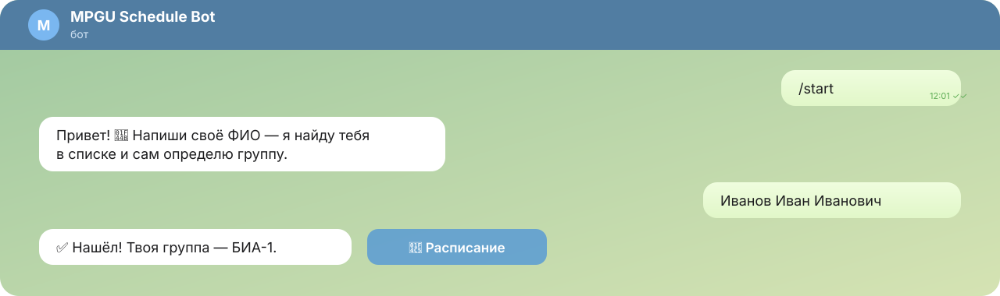

<p align="center"></p>

<div align="center">


</div>

> 💬 **/about** — Бот регистрирует студентов по ФИО из списка группы, а мини-приложение в Telegram показывает каждому расписание его группы. Администратор загружает списки и расписание в админ-панели.

> 🔁 Это вторая версия проекта. Первая — мини-приложение [tg-webapp](https://github.com/lvovkonstantin57-del/tg-webapp), третья и актуальная — самостоятельное приложение **[mpgu-timetable](https://github.com/lvovkonstantin57-del/mpgu-timetable)**.

## `/features` — что умеет

- **Регистрация по ФИО:** студент пишет боту своё имя, бот находит его в списке и сам определяет группу
- **Мини-приложение** с расписанием; каждый запрос подписан Telegram (`initData`), сервер знает, кто спрашивает
- **Админ-панель:** студенты, группы, расписание, семестр и звонки; вход по одноразовому коду `/admin`
- **Импорт и экспорт Excel** (openpyxl)
- **Прокси для Telegram** (SOCKS5/HTTP), если API заблокирован у хостинга
- **Деплой одной командой:** служба systemd + Caddy с HTTPS через sslip.io

## `/files` — из чего состоит

```
bot.py           бот на aiogram 3
api.py           HTTP API для мини-приложения (aiohttp)
db.py            хранилище на SQLite
excel_io.py      импорт и экспорт xlsx
сайт/index.html  мини-приложение
server/          скрипт установки на сервер
deploy.sh        выкладка на сервер
ИНСТРУКЦИЯ.md    подробная инструкция по запуску и работе
```

## `/start` — запуск

```bash
cp .env.example .env          # токен бота, адрес мини-приложения, код админа
pip install -r requirements.txt
python bot.py
```

Установка на сервер — `./deploy.sh root@<IP>`; подробности в [ИНСТРУКЦИЯ.md](ИНСТРУКЦИЯ.md).

---

<sub>Автор — [Константин Львов](https://github.com/lvovkonstantin57-del) · [Telegram](https://t.me/l1ttleStich)</sub>
